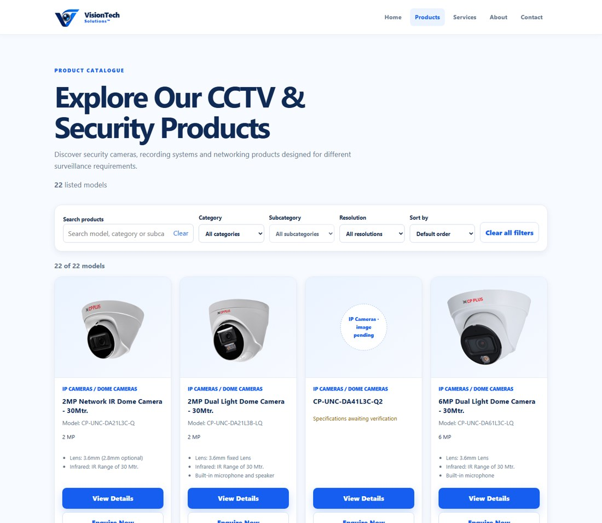
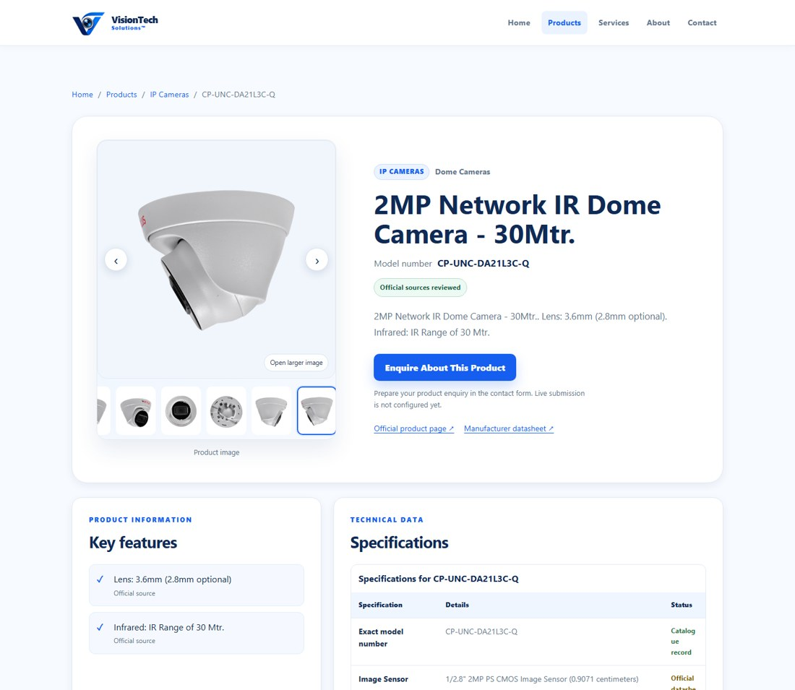
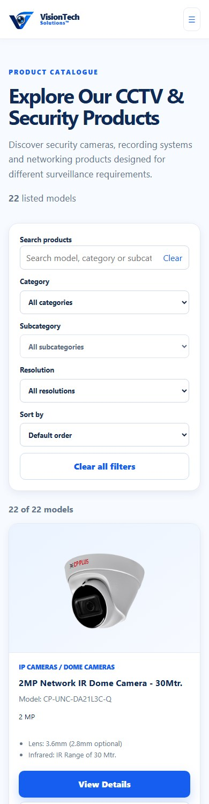
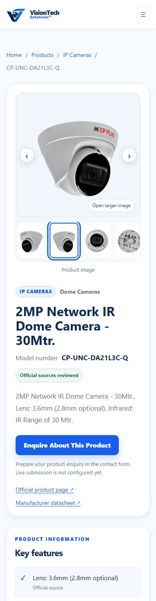

# Product catalogue QA report

Verified locally on 2026-11-15. Scope: product catalogue only; no deployment, database migration, authentication change, or real enquiry submission.

Final result: **145 browser checks passed; 0 failed; 22/22 model routes tested; 40/40 integrated gallery files decoded and selected; 0 normal-page console errors; 0 normal-page HTTP/request failures.** Three products intentionally show placeholders, so this is not a claim that 22 photographs are available.

## Environment and reproducibility

Python + installed Playwright Chromium, headless, loopback ThreadingHTTPServer, real static project files. No frontend build. External browser requests were blocked; no backend enquiry POST was made. Viewports: desktop 1440×1000, tablet 768×1024, mobile 390×844. The VS Code Live Server extension itself was not launched. No production URL was tested.

Run from the project root: `python scripts/test-product-catalogue.py --output <temporary-output-directory>`. Requires the existing Python Playwright package and Chromium installation. The harness uses a local ephemeral port, blocks external URLs, and closes the browser and server on completion. Synthetic form values remain in browser memory and are never saved as customer records.

Raw successful browser evidence: [browser-results.json](catalogue-evidence/browser-results.json). Original full-page PNGs remain in the temporary workspace at `C:\Users\LEGION\Documents\Codex\2026-11-13\p0-02b-disposable-local-supabase-migration\catalogue-qa-verified`. The compact JPEG excerpts below were cropped from those real captures; the detail views reflect the scroll position after thumbnail interaction.

## Per-model results

| Model | Search / exact route / category | Specifications / metadata | Gallery views loaded and selected | Enquiry prefill | Related / image bounds / labels |
| --- | --- | --- | --- | --- | --- |
| CP-UNC-DA21L3C-Q | PASS | PASS | 6 | PASS | PASS |
| CP-UNC-DA21L3B-LQ | PASS | PASS | 7 | PASS | PASS |
| CP-UNC-DA41L3C-Q2 | PASS | PASS | Intentional placeholder: PASS | PASS | PASS |
| CP-UNC-DA61L3C-LQ | PASS | PASS | 1 | PASS | PASS |
| CP-UNC-TA21L3C-Q | PASS | PASS | 6 | PASS | PASS |
| CP-UNC-TA21L3B-LQ | PASS | PASS | 6 | PASS | PASS |
| CP-UNC-TA41L3C-D-Q2 | PASS | PASS | 1 | PASS | PASS |
| CP-UNC-TA61L3C-LQ | PASS | PASS | 1 | PASS | PASS |
| CP-E21Q | PASS | PASS | 1 | PASS | PASS |
| CP-E31Q | PASS | PASS | 1 | PASS | PASS |
| CP-Z42Q | PASS | PASS | Intentional placeholder: PASS | PASS | PASS |
| EZ-M32T | PASS | PASS | 1 | PASS | PASS |
| EZ-R33T | PASS | PASS | 1 | PASS | PASS |
| EZ-S35T | PASS | PASS | 1 | PASS | PASS |
| CP-SL06K | PASS | PASS | 1 | PASS | PASS |
| CP-UNR-104F1 | PASS | PASS | 1 | PASS | PASS |
| CP-UNR-4K2081-V4 | PASS | PASS | 1 | PASS | PASS |
| CP-UNR-4K2162-V3 | PASS | PASS | 1 | PASS | PASS |
| CP-UNR-4K4322-V4 | PASS | PASS | 1 | PASS | PASS |
| CP-ANW-HP4H2-N65 | PASS | PASS | 1 | PASS | PASS |
| CP-DNW-HPU8G2-6-V3 | PASS | PASS | Intentional placeholder: PASS | PASS | PASS |
| CP-ANW-HPU8H2-N12 | PASS | PASS | 1 | PASS | PASS |

## Executed browser checks

| Check | Result |
| --- | --- |
| 22 unique exact model records | PASS |
| All 22 catalogue cards render | PASS |
| 19 catalogue photographs load and use contain | PASS |
| 3 unresolved model cards have clear placeholders | PASS |
| Catalogue image bounds prevent clipping | PASS |
| All detail assertions: CP-UNC-DA21L3C-Q | PASS |
| All detail assertions: CP-UNC-DA21L3B-LQ | PASS |
| All detail assertions: CP-UNC-DA41L3C-Q2 | PASS |
| All detail assertions: CP-UNC-DA61L3C-LQ | PASS |
| All detail assertions: CP-UNC-TA21L3C-Q | PASS |
| All detail assertions: CP-UNC-TA21L3B-LQ | PASS |
| All detail assertions: CP-UNC-TA41L3C-D-Q2 | PASS |
| All detail assertions: CP-UNC-TA61L3C-LQ | PASS |
| All detail assertions: CP-E21Q | PASS |
| All detail assertions: CP-E31Q | PASS |
| All detail assertions: CP-Z42Q | PASS |
| All detail assertions: EZ-M32T | PASS |
| All detail assertions: EZ-R33T | PASS |
| All detail assertions: EZ-S35T | PASS |
| All detail assertions: CP-SL06K | PASS |
| All detail assertions: CP-UNR-104F1 | PASS |
| All detail assertions: CP-UNR-4K2081-V4 | PASS |
| All detail assertions: CP-UNR-4K2162-V3 | PASS |
| All detail assertions: CP-UNR-4K4322-V4 | PASS |
| All detail assertions: CP-ANW-HP4H2-N65 | PASS |
| All detail assertions: CP-DNW-HPU8G2-6-V3 | PASS |
| All detail assertions: CP-ANW-HPU8H2-N12 | PASS |
| Category filter: 4g-cameras | PASS |
| Subcategory filter: 4g-cameras/Bullet Cameras | PASS |
| Subcategory filter: 4g-cameras/Dome Cameras | PASS |
| Subcategory filter: 4g-cameras/PT Cameras | PASS |
| Category filter: ip-cameras | PASS |
| Subcategory filter: ip-cameras/Bullet Cameras | PASS |
| Subcategory filter: ip-cameras/Dome Cameras | PASS |
| Category filter: nvr | PASS |
| Category filter: poe-switches | PASS |
| Category filter: solar-products | PASS |
| Subcategory filter: solar-products/Solar Panel Kits | PASS |
| Category filter: wi-fi-cameras | PASS |
| Subcategory filter: wi-fi-cameras/PT Cameras | PASS |
| Resolution filter: 2 | PASS |
| Resolution filter: 3 | PASS |
| Resolution filter: 4 | PASS |
| Resolution filter: 6 | PASS |
| Sort: az | PASS |
| Sort: za | PASS |
| Sort: resolution | PASS |
| No search results state | PASS |
| Clear all filters restores 22 | PASS |
| Unknown route and noindex | PASS |
| Empty form validation | PASS |
| Unconfigured form reports nothing transmitted | PASS |
| No horizontal overflow 1440: products.html | PASS |
| No image clipping 1440: products.html | PASS |
| No horizontal overflow 1440: product-details.html?model=CP-UNC-DA21L3C-Q | PASS |
| No image clipping 1440: product-details.html?model=CP-UNC-DA21L3C-Q | PASS |
| No horizontal overflow 1440: product-details.html?model=CP-SL06K | PASS |
| No image clipping 1440: product-details.html?model=CP-SL06K | PASS |
| No horizontal overflow 1440: contact.html?type=product&model=CP-E31Q | PASS |
| No image clipping 1440: contact.html?type=product&model=CP-E31Q | PASS |
| No horizontal overflow 768: products.html | PASS |
| No image clipping 768: products.html | PASS |
| No horizontal overflow 768: product-details.html?model=CP-UNC-DA21L3C-Q | PASS |
| No image clipping 768: product-details.html?model=CP-UNC-DA21L3C-Q | PASS |
| No horizontal overflow 768: product-details.html?model=CP-SL06K | PASS |
| No image clipping 768: product-details.html?model=CP-SL06K | PASS |
| No horizontal overflow 768: contact.html?type=product&model=CP-E31Q | PASS |
| No image clipping 768: contact.html?type=product&model=CP-E31Q | PASS |
| No horizontal overflow 390: products.html | PASS |
| No image clipping 390: products.html | PASS |
| No horizontal overflow 390: product-details.html?model=CP-UNC-DA21L3C-Q | PASS |
| No image clipping 390: product-details.html?model=CP-UNC-DA21L3C-Q | PASS |
| No horizontal overflow 390: product-details.html?model=CP-SL06K | PASS |
| No image clipping 390: product-details.html?model=CP-SL06K | PASS |
| No horizontal overflow 390: contact.html?type=product&model=CP-E31Q | PASS |
| No image clipping 390: contact.html?type=product&model=CP-E31Q | PASS |
| Mobile menu opens | PASS |
| Mobile menu closes | PASS |
| Keyboard thumbnail selection | PASS |
| Mobile enquiry exact prefill | PASS |
| Public navigation shell: index.html | PASS |
| Public navigation shell: services.html | PASS |
| Public navigation shell: about.html | PASS |
| Public navigation shell: contact.html | PASS |
| Internal link /products.html#main-content | PASS |
| Internal link /index.html | PASS |
| Internal link /products.html | PASS |
| Internal link /services.html | PASS |
| Internal link /about.html | PASS |
| Internal link /contact.html | PASS |
| Internal link /product-details.html?model=CP-UNC-DA21L3C-Q | PASS |
| Internal link /contact.html?type=product&model=CP-UNC-DA21L3C-Q | PASS |
| Internal link /product-details.html?model=CP-UNC-DA21L3B-LQ | PASS |
| Internal link /contact.html?type=product&model=CP-UNC-DA21L3B-LQ | PASS |
| Internal link /product-details.html?model=CP-UNC-DA41L3C-Q2 | PASS |
| Internal link /contact.html?type=product&model=CP-UNC-DA41L3C-Q2 | PASS |
| Internal link /product-details.html?model=CP-UNC-DA61L3C-LQ | PASS |
| Internal link /contact.html?type=product&model=CP-UNC-DA61L3C-LQ | PASS |
| Internal link /product-details.html?model=CP-UNC-TA21L3C-Q | PASS |
| Internal link /contact.html?type=product&model=CP-UNC-TA21L3C-Q | PASS |
| Internal link /product-details.html?model=CP-UNC-TA21L3B-LQ | PASS |
| Internal link /contact.html?type=product&model=CP-UNC-TA21L3B-LQ | PASS |
| Internal link /product-details.html?model=CP-UNC-TA41L3C-D-Q2 | PASS |
| Internal link /contact.html?type=product&model=CP-UNC-TA41L3C-D-Q2 | PASS |
| Internal link /product-details.html?model=CP-UNC-TA61L3C-LQ | PASS |
| Internal link /contact.html?type=product&model=CP-UNC-TA61L3C-LQ | PASS |
| Internal link /product-details.html?model=CP-E21Q | PASS |
| Internal link /contact.html?type=product&model=CP-E21Q | PASS |
| Internal link /product-details.html?model=CP-E31Q | PASS |
| Internal link /contact.html?type=product&model=CP-E31Q | PASS |
| Internal link /product-details.html?model=CP-Z42Q | PASS |
| Internal link /contact.html?type=product&model=CP-Z42Q | PASS |
| Internal link /product-details.html?model=EZ-M32T | PASS |
| Internal link /contact.html?type=product&model=EZ-M32T | PASS |
| Internal link /product-details.html?model=EZ-R33T | PASS |
| Internal link /contact.html?type=product&model=EZ-R33T | PASS |
| Internal link /product-details.html?model=EZ-S35T | PASS |
| Internal link /contact.html?type=product&model=EZ-S35T | PASS |
| Internal link /product-details.html?model=CP-SL06K | PASS |
| Internal link /contact.html?type=product&model=CP-SL06K | PASS |
| Internal link /product-details.html?model=CP-UNR-104F1 | PASS |
| Internal link /contact.html?type=product&model=CP-UNR-104F1 | PASS |
| Internal link /product-details.html?model=CP-UNR-4K2081-V4 | PASS |
| Internal link /contact.html?type=product&model=CP-UNR-4K2081-V4 | PASS |
| Internal link /product-details.html?model=CP-UNR-4K2162-V3 | PASS |
| Internal link /contact.html?type=product&model=CP-UNR-4K2162-V3 | PASS |
| Internal link /product-details.html?model=CP-UNR-4K4322-V4 | PASS |
| Internal link /contact.html?type=product&model=CP-UNR-4K4322-V4 | PASS |
| Internal link /product-details.html?model=CP-ANW-HP4H2-N65 | PASS |
| Internal link /contact.html?type=product&model=CP-ANW-HP4H2-N65 | PASS |
| Internal link /product-details.html?model=CP-DNW-HPU8G2-6-V3 | PASS |
| Internal link /contact.html?type=product&model=CP-DNW-HPU8G2-6-V3 | PASS |
| Internal link /product-details.html?model=CP-ANW-HPU8H2-N12 | PASS |
| Internal link /contact.html?type=product&model=CP-ANW-HPU8H2-N12 | PASS |
| Internal link /services.html#cctv-installation | PASS |
| Internal link /services.html#cctv-repair | PASS |
| Internal link /services.html#cctv-maintenance | PASS |
| Internal link /services.html#cctv-upgrades | PASS |
| Internal link /services.html#security-consultation | PASS |
| Normal-page console errors | PASS |
| Normal-page HTTP errors | PASS |
| All failed card images show fallbacks | PASS |
| Failed image elements hidden | PASS |
| Failed gallery fallback visible | PASS |
| Failed gallery cannot open | PASS |

## Additional file and source verification

- 22 unique exact model codes, ids and category ids match the original records.
- 42/42 original SHA-256 hashes unchanged; 52/52 original and derivative image files decode.
- All 40 integrated image paths are accepted by the safe path validator; six absolute/traversal/query/encoded/unsupported paths are rejected.
- All 40 published image mappings have exact official-page URL membership plus pre-existing manifest hash evidence; the E31Q duplicate exception is documented.
- Four changed/new rendering JavaScript modules passed node --check.
- Original migrations have no Git diff. No migration or backend security test was run in this frontend milestone.
- Specification rendering was compared to the product records; official-source extraction and conflict review are documented separately in the research report. A rendering test alone cannot establish a manufacturer fact.

## Failures discovered and resolved

The first browser attempt stopped after two models: four general checks passed, then #product-search timed out with connection-refused console errors; two enquiry-prefill reads were premature. The test server connection queue was increased for concurrent assets and the harness now waits for the JS-populated product suggestions rather than the static HTML input. The next run completed all 22 models with 132 checks passing and no console/network errors.

Screenshot review then exposed intrinsic grid sizing clipping valid photos despite contain styling. Image-frame grid tracks were constrained and the main gallery button fills its definite stage. The final rerun added explicit image-bound checks and passed all 145 checks. Screenshots were reviewed again and show complete product bodies in the checked desktop/mobile views.

Intentional 404 tests are isolated in a separate page: all 19 image-enabled catalogue cards show a fallback, broken img elements are hidden, and a fully failed detail gallery displays its fallback and disables enlargement. These expected induced errors are not counted as normal navigation failures.

## Screenshot evidence

## Remaining issues / not tested

CP-UNC-DA41L3C-Q2 has no supplied image or verified official specification source. CP-Z42Q and CP-DNW-HPU8G2-6-V3 have owner-withheld identity-unconfirmed photos and no verified exact official records. Commercial reuse rights are unresolved. Twelve specification fields await clarification. Warranty terms are unverified. Live submission/email/database behavior, authentication, production deployment, cross-browser coverage and search-engine indexing were not tested or changed. Accessibility checks cover labels, table structure, keyboard gallery interaction and overflow; they are not a full WCAG conformance audit.
